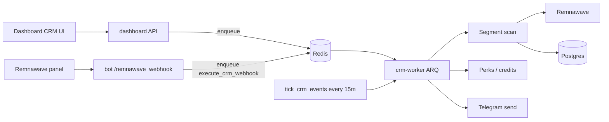

# CRM

The Dashboard **CRM** automates notifications for existing users: segment an
audience, apply Remnawave perks / bonus credits, and send templated Telegram
messages or branded email, including to users without Telegram.

It is **not** a partner/lead CRM. Partnership inquiries from the web portal are
a separate fire-and-forget form — see [Web portal](web-portal.md).

**Source:**

| Layer | Path |
|-------|------|
| UI | `web/apps/dashboard/src/pages/crm/` — route `/crm` |
| API | `services/dashboard/backend/routers/crm.py` — `/bot/dashboard/api/crm/*` |
| Models | `packages/common_db/common_db/models/crm.py` |
| Worker | `crm-worker` container (same image as `dashboard`, ARQ over Redis) |

Ops notes (Redis, worker, UTC schedule): [Deployment](deployment.md).

## Prerequisites

| Dependency | Role |
|------------|------|
| `redis` | Job queue for campaign execution |
| `crm-worker` | ARQ worker — runs campaigns, scheduled events, and Remnawave webhook rules |
| Remnawave | Segment scans and perk actions |
| Bot token | Telegram delivery (`send_message` / buttons) |
| SMTP | Email delivery; the same runtime settings and encrypted password as verification codes |

If Redis or `crm-worker` is down, campaign launch returns **HTTP 503**.

```bash
docker compose up -d redis crm-worker
```

`REDIS_URL` defaults to `redis://redis:6379/0` in compose.

---

## Dashboard UI

**Route:** `/crm`

Tabs:

| Tab | Purpose |
|-----|---------|
| **Кампании (Campaigns)** | Build conditions + actions → preview audience → launch once |
| **События (Events)** | Recurring schedules (UTC); worker fires them automatically |
| **Webhooks** | Remnawave inbound events (`scope` + `event`) → CRM actions |
| **История (History)** | Past campaigns: sent / failed / perk counters, delivery detail |

### Typical campaign workflow

1. Open **Кампании**.
2. Add a **segment** condition (required) and optional filters.
3. Add one or more **actions** (Remnawave perks, credits, message).
4. **Preview** — live evaluate conditions (`POST /crm/conditions/evaluate`).
5. Optionally narrow recipients with **manual tg_id allowlist**.
6. **Launch** → job enqueued to Redis → `crm-worker` delivers → jump to History.

### Scheduled events

1. Open **События** → create event with the same conditions/actions model.
2. Set `run_at_time` (UTC `HH:MM`), frequency (`daily` / `weekly` + weekday),
   and repeat policy (`always` / `once` / `cooldown` + cooldown days).
3. Worker cron `tick_crm_events` runs every **15 minutes**.
4. At fire time: **fresh segment scan** (not a frozen recipient list) → linked
   campaign created (`event_id` FK) → deliveries tracked in `crm_event_deliveries`.
5. **Run now:** `POST /crm/events/{id}/run-now` from the Events tab.

Postgres stores `next_run_at` so schedules survive Redis restarts.

### Remnawave webhook rules

1. Open **Webhooks** → create a rule with **scope** + **event** (from the Remnawave
   catalog: `user`, `torrent_blocker`, `user_hwid_devices`).
2. Configure the same **actions** as campaigns (message, perks, credits).
3. Optional **cooldown hours** — skip re-delivery to the same user within the window.
4. Panel POSTs to `/bot/remnawave_webhook` → bot enqueues → `crm-worker` runs matching rules.

Webhook-only variables (also available with the usual CRM placeholders):
`{{notConnectedAfterHours}}`, `{{deviceModel}}`, `{{platform}}`, `{{osVersion}}`,
`{{ip}}`, `{{blockMinutes}}`.

---

## Conditions → actions model

Since migration `0018_crm_conditions_actions`, campaigns and events store:

- `conditions_json` — audience rules (AND'd)
- `actions_json` — ordered side effects

Legacy flat columns (`segment_type`, `message_text`, `bonus_days`, …) are kept
as a mirror for history and older API clients via `crm_model_adapter.py`.

Deploy **dashboard frontend and backend together** when changing CRM shape.

### Conditions (AND)

| Type | Required | Description |
|------|----------|-------------|
| `segment` | **Yes** (max 1) | Remnawave + local DB segment scan |
| `user_type` | No | `all` / free / paid_vip |
| `tg_allowlist` | No | Restrict to selected `tg_id`s after preview |
| `user_allowlist` | No | Restrict to selected local `user_id`s, including email-only accounts |
| `rw_internal_squad` | No | User is in the given Remnawave internal squad |
| `rw_traffic_limit` | No | Traffic limit in GB (`0` = unlimited) |
| `rw_tag` | No | Remnawave user tag (UPPERCASE, no spaces) |

### Segments

| ID | Meaning | Extra params |
|----|---------|--------------|
| `all_users` | Non-banned Telegram users; email actions also include verified email accounts | — |
| `never_connected` | Has subscription, no `firstConnectedAt` | — |
| `expired` | Remnawave status `expired` | — |
| `limited` | Status `limited` (traffic exhausted) | — |
| `traffic_low` | Used ≥ threshold of traffic limit | `traffic_threshold` (0.5–0.95) |
| `expiring_soon` | ≤ N days until `expire_at` | `days_threshold` (1–30) |
| `unpaid_invoice` | Local txs with status `created` | `invoice_max_age_hours` |
| `torrent` | From torrent-blocker reports | `torrent_days` |
| `device_limit` | Devices ≥ `hwidDeviceLimit` | — |

Catalog: `GET /crm/segments`. Evaluation: `POST /crm/conditions/evaluate`.

### Actions (ordered)

At least one enabled action is required. Remnawave / wallet actions run
**before** message delivery.

| Type | Category | Effect |
|------|----------|--------|
| `rw_bonus_days` | Remnawave | Extend subscription by N days |
| `rw_bonus_traffic` | Remnawave | Add N GB traffic |
| `rw_reset_traffic` | Remnawave | Reset used traffic |
| `rw_set_status` | Remnawave | *(disabled in catalog)* |
| `credit_balance` | Wallet | Credit `users.bonus_credits` (`SOURCE_CRM`) |
| `send_message` | Telegram | HTML message with `{{variables}}` |
| `send_email` | Email | Branded email with subject, plain-text message and `{{variables}}` |
| `attach_button` | Telegram | `open_bot` or `invite_friends` deeplink |

Catalog: `GET /crm/actions/types`.

### Email action

`Send email` is available in Campaigns, Events and Webhooks. Enter a subject
(up to 200 characters) and message (up to 20,000 characters). Both support CRM
variables, including webhook variables. Text is escaped and line breaks are
preserved; HTML is not interpreted. The email includes the configured branding
name, cached logo as an inline PNG, and team signature.
A plain-text MIME alternative is included.

Recipients default to **Only users without Telegram** (`recipients=without_telegram`).
Choose **All users with a verified email** (`recipients=all`) to also email users
who have linked Telegram. Unverified or missing addresses are skipped. Combine
the default email action with `send_message` to reach both channels without
duplicate notifications for linked accounts. Telegram actions skip email-only
accounts. SMTP failures count as failed messages.

**Preview email** renders the same template with sample variable values and
never sends mail (`POST /crm/emails/preview`, authenticated). The CRM worker
loads the same SMTP runtime overlay as the verification-code service and polls
for configuration changes.

Deploy the dashboard API, CRM worker, MiniApp backend, and dashboard frontend
together. Migration `0047_crm_email_recipients` makes delivery `tg_id` nullable,
adds stable local `user_id` tracking, and backfills older Telegram deliveries.
Events freeze audiences by local user ID; once/cooldown and webhook cooldown
continue to work when an email-only account links Telegram or changes email.

#### Email address from a webhook

In **Webhooks → Send email**, enable **Send to email from webhook**
(`send_to_email_from_webhook=true`) to use the account email in the signed
Remnawave payload instead of the address in the local database. This mode works
without a local user and ignores Telegram linking and local email verification.
The normal recipient selector is hidden while this option is on. Campaigns and
Events do not support this option.

The documented account fields are `data.user.email` for Torrent Blocker and
HWID events, and `data.email` for user events. The Xray report's
`data.report.xrayReport.email` is an unrelated identifier and is never used as
the recipient. See the [Remnawave webhook schema](https://docs.rw/api/#models/RemnawaveWebhookTorrentBlockerEventsDto).

An absent or invalid account email skips delivery, without falling back to the
database address. Message variables come from the webhook account and event.
No new local user is created; other actions in the rule still require an
eligible local user. The SMTP sender and approved monochrome template are shared
with regular CRM email.

Migration `0048_crm_webhook_email` adds `recipient_email` to webhook deliveries.
Cooldown is tracked by rule and normalized email, independently of the local
user cooldown. Successful deliveries start cooldown; SMTP failures increment
the failure counter and allow a later webhook to try again.

### Message variables

Templates support `{{ key }}` placeholders:

| Key | Example |
|-----|---------|
| `username` | `@alice` |
| `days_left` | `3` |
| `traffic_left` | `2 ГБ` |
| `traffic_percent` | `85` |
| `hwid_devices` | `2` |
| `status` | `limited` |

Catalog: `GET /crm/variables`. For webhook rules use `GET /crm/variables?context=webhook`
(adds webhook-only keys). Segment-specific canned texts: `GET /crm/templates?segment_id=…`.

---

## Data model

| Table | Purpose |
|-------|---------|
| `crm_campaigns` | Ad-hoc + event-spawned campaigns (`conditions_json`, `actions_json`, status counters) |
| `crm_campaign_deliveries` | Per-recipient result for a campaign |
| `crm_events` | Scheduled event definitions + `next_run_at` |
| `crm_event_deliveries` | De-dup / repeat-policy tracking for events |
| `crm_webhook_rules` | Remnawave webhook scope/event → actions (+ received/sent/failed counters) |
| `crm_webhook_deliveries` | Cooldown tracking for webhook rules |

Repos: `common_db.repo.crm`, `crm_events`, `crm_webhooks`, `crm_segments`.

---

## API surface (summary)

All under `/bot/dashboard/api/crm/` (JWT required):

| Area | Endpoints |
|------|-----------|
| Catalogs | `GET /segments`, `/conditions/types`, `/actions/types`, `/variables`, `/templates` |
| Preview | `POST /conditions/evaluate` |
| Campaigns | `GET /campaigns`, `POST /campaigns/launch`, `GET /campaigns/{id}` |
| Events | `GET/POST /events`, `PATCH/DELETE /events/{id}`, `POST /events/{id}/run-now` |
| Webhooks | `GET /webhooks/catalog`, `GET/POST /webhooks`, `PATCH/DELETE /webhooks/{id}` |
| Remnawave helpers | `GET /remnawave/internal-squads` |

---

## Architecture



---

## Troubleshooting

| Symptom | Fix |
|---------|-----|
| Launch returns 503 | Start `redis` + `crm-worker`; check `REDIS_URL` |
| Events never fire | Confirm `crm-worker` logs for `tick_crm_events`; times are **UTC** |
| Webhook rules never run | Confirm bot has `REDIS_URL`, `crm-worker` running, rule enabled + matching scope/event |
| Empty audience | Preview conditions; Remnawave connectivity; `user_type` filter too strict |
| Message sent, no perk | Check History delivery errors; Remnawave token / user UUID mapping |
| UI/API mismatch after update | Redeploy dashboard **frontend and backend** together |

## Related

- [Referral & promocodes](referral.md) — bonus credits wallet used by `credit_balance`
- [Dashboard](dashboard.md) — nav overview
- [Deployment](deployment.md) — Redis / worker / scheduling
- [Integrations](integrations.md) — Remnawave inbound webhooks → CRM Webhooks tab
